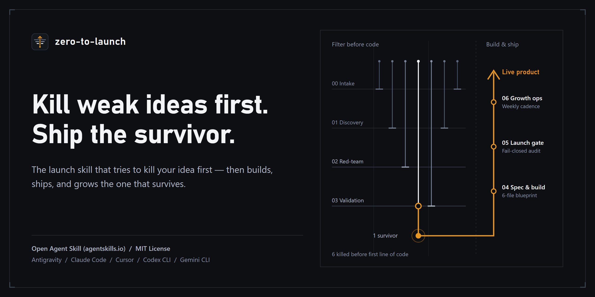
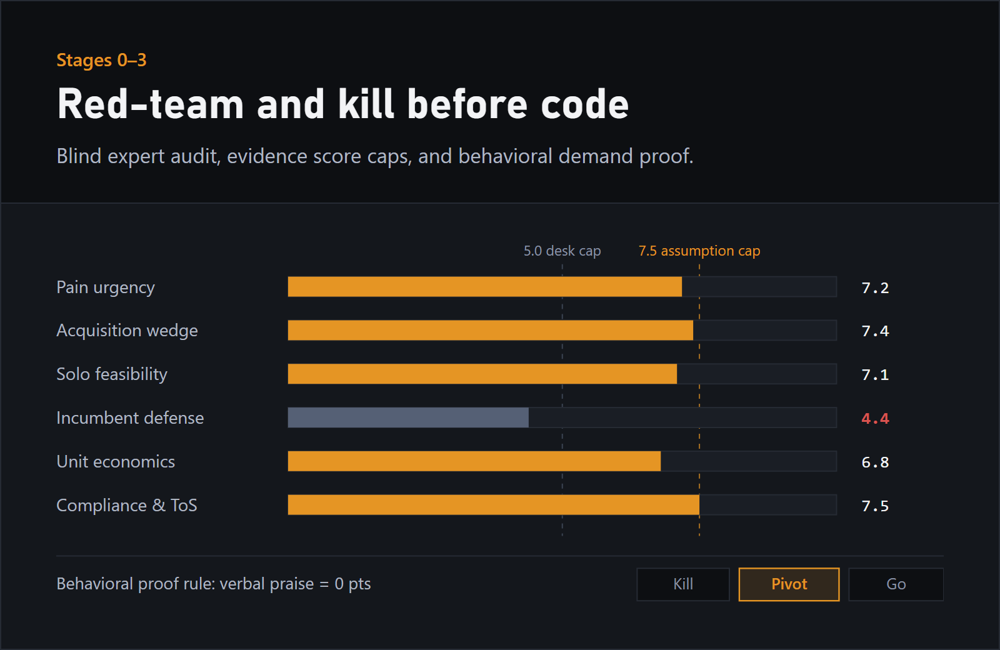
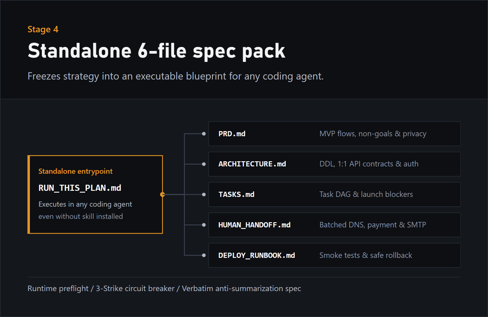
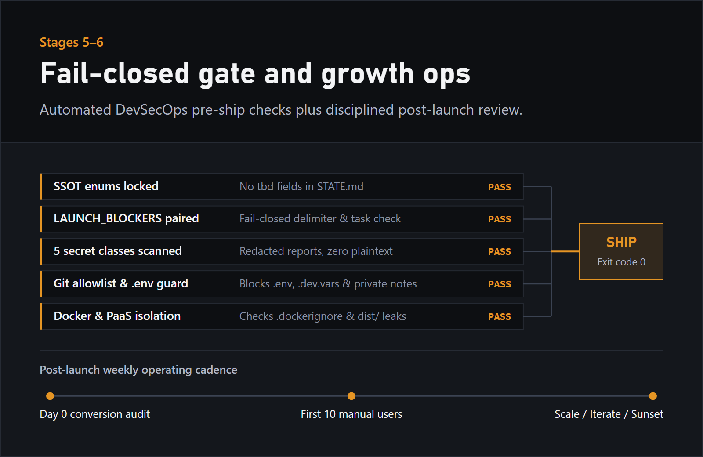
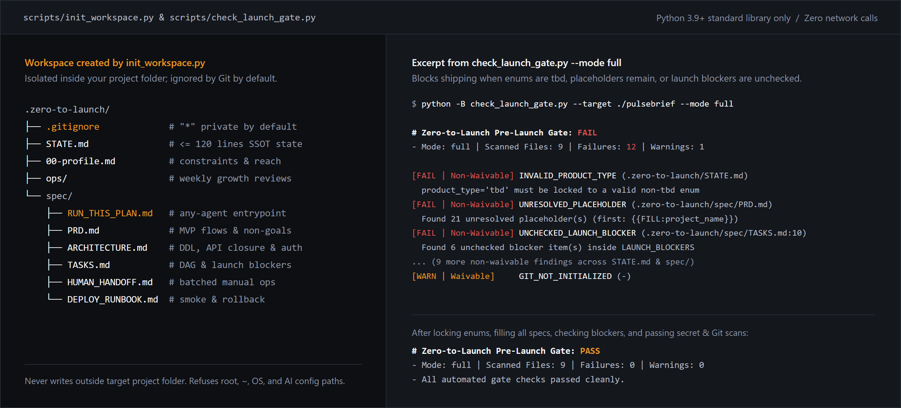

<p align="center">
  
</p>

<h1 align="center">zero-to-launch</h1>

<p align="center">
  <strong>The launch skill that tries to kill your idea first — then builds, ships, and grows the one that survives.</strong>
</p>

<p align="center">
  <a href="https://github.com/zhaomason1991/zero-to-launch/actions/workflows/validate-skill.yml"></a>
  <a href="LICENSE"></a>
  <a href="https://agentskills.io"></a>
</p>

<p align="center">
  <strong>English</strong> &nbsp;/&nbsp; <a href="README_CN.md">简体中文</a>
</p>

<p align="center">
  
</p>

Most AI coding tools cheerlead your first idea and start writing code in five minutes. Yet in [CB Insights' March 2026 analysis of 431 VC-backed startups that shut down since 2023](https://www.cbinsights.com/research/startup-failure-reasons-top/), running out of capital (70%) was only the final symptom—the deeper root causes were **poor product-market fit (43%)**, **bad timing (29%)**, and **unsustainable unit economics (19%)**. Shipping faster does not help if the product should never have been built, or if it ships with leaked keys and zero distribution.

`zero-to-launch` is an open-standard **Agent Skill** (`SKILL.md`) for **Antigravity, Claude Code, Cursor, Codex CLI, and Gemini CLI**. It puts an adversarial, disciplined launch operating system inside your coding agent: first it tries to disprove your idea with blind multi-domain red-teaming and behavioral demand gates; only when one survives does it compile a standalone 6-file engineering spec pack, enforce an automated Fail-Closed pre-launch security gate, and run a weekly post-launch growth cadence. Speak in any language—the skill mirrors your language automatically while keeping machine-readable state intact.

---

## Core Capabilities

<table>
  <tr>
    <td width="33.3%"></td>
    <td width="33.3%"></td>
    <td width="33.3%"></td>
  </tr>
  <tr>
    <td valign="top"><b>Kill weak ideas early</b><br/><sub>Atomic constraint intake, anti-hype discovery, blind expert red-team with <code>5.0 / 7.5</code> evidence caps, and behavioral proof where verbal praise scores <code>0</code>.</sub></td>
    <td valign="top"><b>Executable 6-file handoff</b><br/><sub>Compiles frozen strategy into <code>RUN_THIS_PLAN.md</code> + 5 engineering specs so <i>any</i> coding agent can build and test without skill lock-in.</sub></td>
    <td valign="top"><b>Fail-closed ship &amp; growth</b><br/><sub>Zero-dependency Python 3.9+ security gate (secrets, Git allowlist, Docker/PaaS leaks) plus Day 0 audit, First 10 Users, and Scale/Iterate/Sunset reviews.</sub></td>
  </tr>
</table>

---

## How a Launch Runs

0. **Intake & Hard Constraints** — Asks one atomic question at a time to lock your North Star, cash cap, `70%` effective pre-launch hours, post-launch ops ceiling, existing reach assets, and developer jurisdiction.
1. **Opportunity & Anti-Hype Audit** — Supports both bringing your own idea (Track A stress-test) and starting from zero (Track B money-trail discovery), rejecting viral luck and verifying live-date competitors.
2. **Multi-Domain Expert Red-Team** — Runs blind subagent audits (or a mandatory Pre-Mortem fallback) across 6 scored dimensions with evidence caps and hard vetoes before freezing a V2 plan.
3. **Behavioral Demand Validation** — Tests willingness to act using pre-registered `Go / Pivot / Kill` thresholds where polite compliments ("I'd totally use this!") score zero.
4. **6-File Spec Pack & Safe Build Loop** — Runs runtime preflight, audits 6 common managed-service traps, writes the verbatim 6-file spec pack, and builds task-by-task with a 3-Strike circuit breaker.
5. **DevSecOps Launch Gate & Ship** — Runs `check_launch_gate.py` (SSOT enums, `LAUNCH_BLOCKERS`, 5 redacted secret classes, Git tracking, Docker/PaaS packaging), executes smoke tests, and verifies non-destructive rollback.
6. **Cold Start & Weekly Growth Ops** — Runs a Day 0 conversion audit, manual First 10 Users outreach, reconciled unit economics, Feature Freeze under low traffic, and a 6-step Graceful Sunset SOP if metrics miss.

<details>
<summary>Deep dive: red-team scorecards, cross-border compliance, and gate rules</summary>

- **Three 100%-weight 6-dimension scorecards** tailored to `commercial`, `free-oss`, and `internal-tool` archetypes, capped at `<= 5.0` for unverified desk facts and `<= 7.5` for unverified primary assumptions, with max 2 redesign rounds (`V1 -> V2 -> V3`).
- **On-demand cross-border compliance (`module-cross-border-compliance.md`)**: Loaded automatically when `cross_border: true`; verifies live-date developer jurisdiction eligibility, payment/MoR boundaries, GDPR Art. 17 erasure, AI retention disclosures, and OSS copyleft rules.
- **Automated `check_launch_gate.py` checks**: Rejects `tbd` SSOT enums, unresolved `{{FILL:...}}` tokens, missing/unpaired `LAUNCH_BLOCKERS` delimiters, unchecked blockers, 5 secret classes (including `.zero-to-launch/archive/` and frontend `NEXT_PUBLIC_*SECRET*` leaks—never printing plaintext secrets), `MOCK_*=true` in production configs, tracked/unignored `.env*` & `.dev.vars*`, non-allowlisted `.zero-to-launch/` files in Git, missing `.dockerignore`/PaaS exclusions, `dist/.zero-to-launch` build leaks, and fails closed if `--max-files` is exceeded.
- **CI verified across 4 environments**: `scripts/validate_repo.py --release` runs full metadata, link, privacy, and isolated unit tests on `ubuntu-latest` and `windows-latest` across Python `3.9` and `3.12`.

</details>

---

## What You Actually Get

<p align="center">
  
</p>

Once Stage 4 freezes `.zero-to-launch/spec/`, your plan is completely portable. Even an agent on another machine **without** `zero-to-launch` installed can pick it up cleanly:

> *"Read `.zero-to-launch/spec/RUN_THIS_PLAN.md` and follow its instructions step-by-step to build, test, audit, and deploy this product."*

Want to see an end-to-end example first? Read our fully **fictional, anonymized** walkthrough in [examples/sample-walkthrough.md](examples/sample-walkthrough.md).

---

## Start Where You Are

You do not have to start from Stage 0. Open your agent in a project folder and use any of these prompts (in English, Chinese, or any language):

- **Zero idea (full 0-to-1):** *"Use zero-to-launch: I have no product idea yet, 8 hours/week, and a $300 budget. Help me discover, red-team, validate, build, and launch a real digital product."*
- **Have an idea (red-team first):** *"Use zero-to-launch to stress-test my idea for a $19/mo browser extension before writing a single line of code."*
- **Existing codebase (read-only Stage 5 audit):** *"Run zero-to-launch Stage 5 standalone security and launch-readiness gate on this repository."*
- **Already live (Stage 6 growth ops):** *"Use zero-to-launch Stage 6 on my live product to audit conversion surfaces and set up a weekly operating cadence."*

---

## Install

```bash
npx skills add zhaomason1991/zero-to-launch
```

*Privacy & Windows notes:* Prefix with `DO_NOT_TRACK=1` (POSIX) or `$env:DO_NOT_TRACK="1";` (PowerShell) to disable `skills.sh` CLI telemetry. On Windows PowerShell where `.ps1` scripts are restricted by default, invoke `npx.cmd` instead of weakening ExecutionPolicy:

```powershell
$env:DO_NOT_TRACK="1"; npx.cmd skills add zhaomason1991/zero-to-launch
```

<details>
<summary>Zero-CLI manual / Git install paths (Antigravity, Claude Code, Cursor, Codex CLI, Gemini CLI)</summary>

Clone this repository (or download a release ZIP) and copy `skills/zero-to-launch/` into your agent's official skills directory:

| Agent / Tool | Project-Level Path | User-Level Path (Global) |
| :--- | :--- | :--- |
| **Antigravity (Skill)** | `.agents/skills/zero-to-launch/` | `~/.gemini/config/skills/zero-to-launch/` *(Windows: `%USERPROFILE%\.gemini\config\skills\zero-to-launch\`)* |
| **Antigravity (Plugin)** | `.agents/plugins/zero-to-launch/` *(entire repo)* | `~/.gemini/config/plugins/zero-to-launch/` *(entire repo)* |
| **Claude Code** | `.claude/skills/zero-to-launch/` | `~/.claude/skills/zero-to-launch/` |
| **Cursor** | `.cursor/skills/zero-to-launch/` *(or `.agents/skills/`)* | `~/.cursor/skills/zero-to-launch/` |
| **Codex CLI** | `.codex/skills/zero-to-launch/` *(or `.agents/skills/`)* | `~/.codex/skills/zero-to-launch/` |
| **Gemini CLI** | `.gemini/skills/zero-to-launch/` | `~/.gemini/skills/zero-to-launch/` |

</details>

---

## Trust, Safety & What It Does Not Do

**Local footprint & safety guarantees**
- **Strict write boundary:** Writes only inside your chosen project's `.zero-to-launch/` directory (and your product code during Stage 4). `init_workspace.py` actively refuses filesystem roots, `~`, OS directories, AI config directories, UNC paths, and `SKILL_DIR`.
- **Private by default:** Automatically writes `.zero-to-launch/.gitignore` containing `*` so personal constraints, strategies, and handoff notes cannot be accidentally pushed to Git.
- **Zero hidden dependencies:** Helper scripts use **Python 3.9+ standard library only** (`0` external `pip` packages), make **zero outbound network calls**, and redact all detected secrets in output. Never edits `~/.gemini/config/config.json` or system PowerShell policy.
- **Clean uninstall:** Delete the `zero-to-launch/` folder from your agent's skills/plugins directory (and optionally `.zero-to-launch/` inside any project).

**What `zero-to-launch` does NOT do**
- It does **not** guarantee revenue, virality, or product-market fit—it increases your odds by killing weak assumptions before you spend weeks coding them.
- It does **not** replace talking to real prospective buyers during Stage 3 validation or Stage 6 cold start.
- It does **not** create accounts, buy domains, configure payment processors, or sign legal terms on your behalf; all real-money and identity actions stay explicit `[STOP-FOR-HUMAN]` checkpoints.

---

## Methodology & Acknowledgements

Built on ideas from *The Mom Test* (Rob Fitzpatrick), *Pre-Mortem Analysis* (Gary Klein), *Customer Development & Lean Startup* (Steve Blank & Eric Ries), and the open [Agent Skills specification](https://agentskills.io).

---

Made by [@zhaomason1991](https://github.com/zhaomason1991) (X: [@Shanchargo](https://x.com/Shanchargo)). Released under the [MIT License](LICENSE). See [SECURITY.md](SECURITY.md), [CONTRIBUTING.md](CONTRIBUTING.md), and [CHANGELOG.md](CHANGELOG.md).
