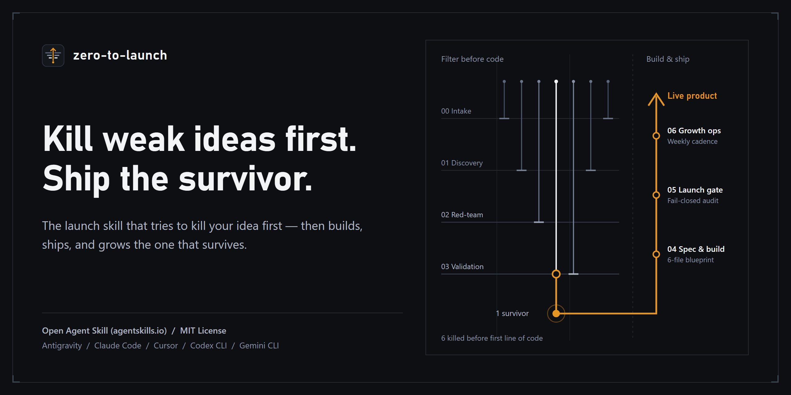
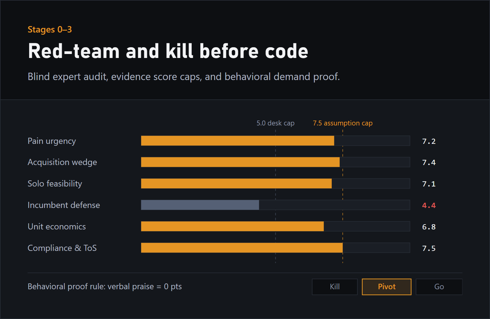
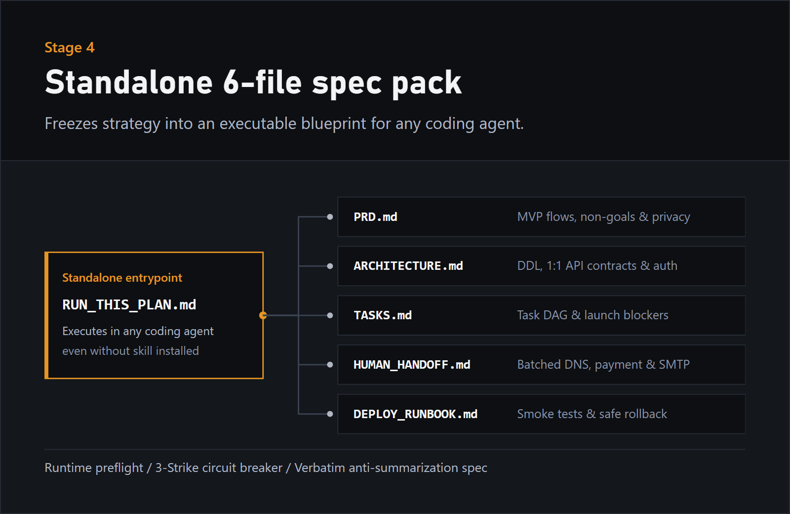
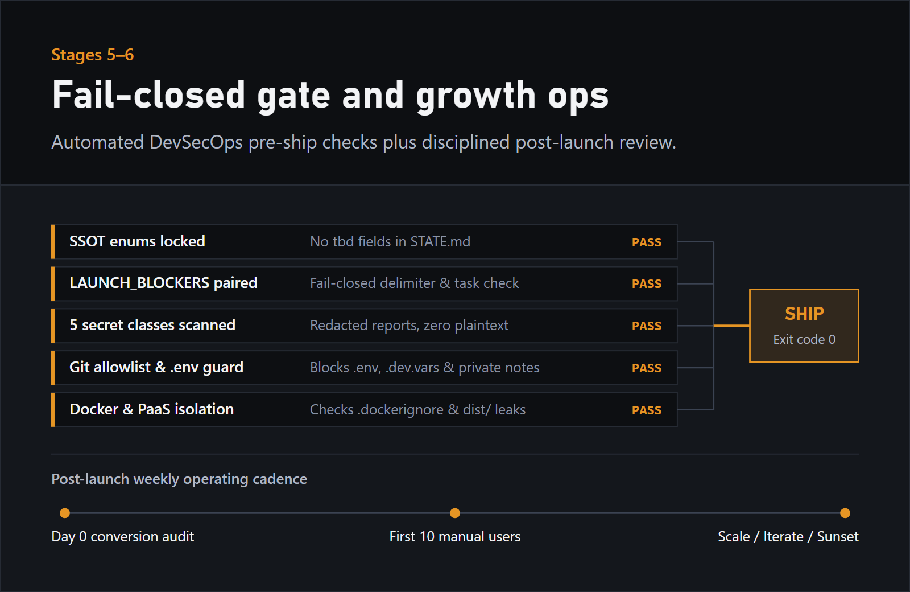
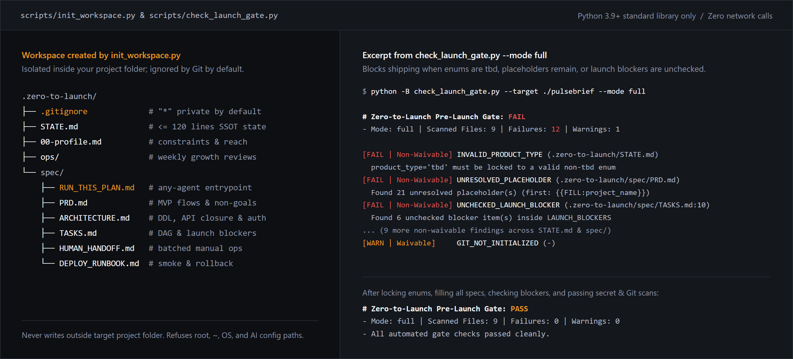

<p align="center">
  
</p>

<h1 align="center">zero-to-launch</h1>

<p align="center">
  <strong>先试图干掉你的点子，再把活下来的那个造出来、发上线、做增长。</strong>
</p>

<p align="center">
  <a href="https://github.com/zhaomason1991/zero-to-launch/actions/workflows/validate-skill.yml"></a>
  <a href="LICENSE"></a>
  <a href="https://agentskills.io"></a>
</p>

<p align="center">
  <a href="README.md">English</a> &nbsp;/&nbsp; <strong>简体中文</strong>
</p>

<p align="center">
  
</p>

大多数 AI 编程工具都会顺着你的第一个念头鼓掌，五分钟内就开始帮你写代码。但据 [CB Insights 2026 年 3 月对 2023 年以来 431 家公开关停的 VC 融资创业公司复盘](https://www.cbinsights.com/research/startup-failure-reasons-top/)，资金耗尽（70%）往往只是最终死因，背后更本质的根源是**缺乏产品市场契合（PMF，43%）**、**时机错误（29%）**以及**单位经济不可持续（19%）**。如果一个产品本来就不该做，或者带着密钥泄露与零获客渠道上线，写代码再快也毫无意义。

`zero-to-launch` 是一个遵循开放标准（`SKILL.md` / `agentskills.io`）的跨平台 **Agent Skill**，兼容 **Antigravity、Claude Code、Cursor、Codex CLI 与 Gemini CLI**。它为你的编码 Agent 装上一套冷酷、完整的产品上线操作系统：先用多领域专家红队盲审与行为证据试着证伪你的想法；只有活下来的那一个，才会被编译成反摘要化的 6 件套工程规格包，走完自动化 Fail-Closed 上线安全门禁，并进入上线后的周度增长运营节拍。内置**语言自动镜像（Language Mirroring）**——你用中文发问，全程简体中文对话并产出中文文档，同时底层机读状态字段保持英文精确无损。

---

## 核心能力一览

<table>
  <tr>
    <td width="33.3%"></td>
    <td width="33.3%"></td>
    <td width="33.3%"></td>
  </tr>
  <tr>
    <td valign="top"><b>写代码前先排雷止损</b><br/><sub>单题摸底真实约束，反吹捧机会体检，盲审专家红队叠加 <code>5.0 / 7.5</code> 证据封顶，以及“口头赞美记 <code>0</code> 分”的行为验证门。</sub></td>
    <td valign="top"><b>不绑死工具的 6 件套规格包</b><br/><sub>把冻结后的战略编译成 <code>RUN_THIS_PLAN.md</code> 与 5 份工程文档，哪怕换到<b>未安装本 Skill</b> 的其他编码 Agent 也能直接按图施工。</sub></td>
    <td valign="top"><b>Fail-Closed 上线门禁与运营</b><br/><sub>零依赖 Python 3.9+ 自动化安全拦截（密钥、Git 白名单、Docker/PaaS 隔离），配合 Day 0 转化预检、首批 10 用户与周复盘。</sub></td>
  </tr>
</table>

---

## 一次完整上线怎么跑（7 阶段）

0. **画像与硬约束摸底** — 每次只问一个原子问题，锁定北极星目标、现金上限、`70%` 有效上线前工时、上线后周运维上限、现有触达资产与开发者属地。
1. **机会发现与反吹捧体检** — 同时支持“自带想法做排雷（Track A）”与“零点子沿付费线索找机会（Track B）”，拒绝靠运气爆火的方案并实时核查竞品。
2. **多领域专家红队审计** — 启动无上下文偏见的子代理盲审（或强制事前验尸回退），按 6 维评分卡、证据封顶与一票否决重构为冻结版 V2 方案。
3. **行为证据需求验证** — 用事前锁定的 `Go / Pivot / Kill` 门槛验证真实行动意愿，朋友的口头夸奖（“做出来我一定用”）一律记零分。
4. **6 件套规格包与 AI 闭环施工** — 先跑运行环境预检并排查 6 类托管服务生产陷阱，生成逐字可执行的 6 件套工程规格包，再按任务 DAG 与 3-Strike 熔断逐项构建。
5. **DevSecOps 上线门禁与发布** — 运行 `check_launch_gate.py` 过完 5 重硬检查（状态枚举、阻塞项、5 类密钥脱敏扫描、Git 追踪、Docker/PaaS 打包隔离），验证冒烟测试与非破坏性回滚后上线。
6. **冷启动与周度增长运营** — 执行 Day 0 转化面审计、首批 10 位种子用户手工触达、算术对账单位经济、低流量功能冻结，以及未达标时的 6 步体面关停 SOP。

<details>
<summary>展开查看：红队评分卡、跨境合规模块与自动化门禁细则</summary>

- **3 套满分 100% 权重的 6 维红队评分卡**：分别对应商业化产品（`commercial`）、免费开源项目（`free-oss`）与内部工具（`internal-tool`）；二手桌面信息封顶 `<= 5.0`，未经一手验证的核心假设封顶 `<= 7.5`，最多 2 轮重构（`V1 -> V2 -> V3`）。
- **按需加载跨境合规模块（`module-cross-border-compliance.md`）**：当 `cross_border: true` 时自动介入，按当天实网核验开发者属地可用性、支付/MoR 税务边界、GDPR 第 17 条删除权、AI 数据留存披露与开源协议传染风险。
- **`check_launch_gate.py` 自动化 Fail-Closed 规则**：拦截未锁定的 `tbd` 枚举、残留 `{{FILL:...}}` 占位符、缺失或错配的 `LAUNCH_BLOCKERS` 界标、未勾选上线阻塞项、5 类密钥泄露（覆盖 `.zero-to-launch/archive/` 及前端 `NEXT_PUBLIC_*SECRET*` 泄露，报告全程脱敏绝不输出明文）、生产配置中的 `MOCK_*=true`、Git 中追踪或未忽略的 `.env*` / `.dev.vars*`、非白名单 `.zero-to-launch/` 私有文档、缺失 `.dockerignore` / PaaS 排除规则、`dist/.zero-to-launch` 构建产物泄露，且扫描文件超限时 Fail-Closed 拒绝放行。
- **4 环境矩阵 CI 持续实测**：`scripts/validate_repo.py --release` 在 `ubuntu-latest` 与 `windows-latest` × Python `3.9` 与 `3.12` 上自动执行元数据、链接、隐私与全套隔离单元测试。

</details>

---

## 你实际会拿到什么

<p align="center">
  
</p>

当 Stage 4 冻结 `.zero-to-launch/spec/` 后，这套交付物完全独立可迁移。哪怕换到另一台**未安装本 Skill** 的设备或其他编程 Agent，只需发一句：

> “请先完整阅读 `.zero-to-launch/spec/RUN_THIS_PLAN.md`，严格按其中铁律与任务顺序，一步步完成开发、测试、安全质检并部署上线。”

想先看一个完整端到端输出样例？可以阅读这份**完全虚构、已脱敏**的实战演练记录：[examples/sample-walkthrough.md](examples/sample-walkthrough.md)。

---

## 按你的当前阶段直接切入

不需要每次都从零开始。在任意项目目录打开你的 AI 工具，直接发下面任一句（中英文皆可）：

- **零点子从 0 到 1：** *“使用 zero-to-launch：我目前没有具体想法，每周能投入 8 小时、启动预算 300 美元，帮我发现、红队排雷、验证并构建上线一个靠谱的数字产品。”*
- **已有想法先排雷：** *“使用 zero-to-launch，在写第一行代码前，帮我对这个 19 美元/月的浏览器插件想法做红队审计。”*
- **存量代码只做上线安全质检（只读）：** *“按 zero-to-launch 的 Stage 5 Standalone 只读模式，帮我审计当前仓库的上线安全与打包防泄密风险。”*
- **产品已上线做增长运营：** *“对这个已上线产品运行 zero-to-launch Stage 6，审计转化面并建立周度增长复盘节拍。”*

---

## 一键安装

```bash
npx skills add zhaomason1991/zero-to-launch
```

*隐私与 Windows 提示：* 如需关闭 `skills.sh` 匿名统计，可加 `DO_NOT_TRACK=1`（macOS/Linux）或 `$env:DO_NOT_TRACK="1";`（PowerShell）。Windows PowerShell 默认禁用 `.ps1` 脚本时，**无需修改系统安全策略**，直接运行 `npx.cmd` 即可：

```powershell
$env:DO_NOT_TRACK="1"; npx.cmd skills add zhaomason1991/zero-to-launch
```

<details>
<summary>展开查看：零第三方 CLI 纯 Git / ZIP 手动安装路径（全平台对照表）</summary>

克隆本仓库（或下载 Release ZIP 解压），将 `skills/zero-to-launch/` 复制到对应 AI 工具的官方目录：

| AI 工具 / 平台 | 项目级目录（单项目） | 用户级目录（全局） |
| :--- | :--- | :--- |
| **Antigravity（Skill）** | `.agents/skills/zero-to-launch/` | `~/.gemini/config/skills/zero-to-launch/` *(Windows：`%USERPROFILE%\.gemini\config\skills\zero-to-launch\`)* |
| **Antigravity（Plugin）** | `.agents/plugins/zero-to-launch/` *(整仓放入)* | `~/.gemini/config/plugins/zero-to-launch/` *(整仓放入)* |
| **Claude Code** | `.claude/skills/zero-to-launch/` | `~/.claude/skills/zero-to-launch/` |
| **Cursor** | `.cursor/skills/zero-to-launch/` *(或 `.agents/skills/`)* | `~/.cursor/skills/zero-to-launch/` |
| **Codex CLI** | `.codex/skills/zero-to-launch/` *(或 `.agents/skills/`)* | `~/.codex/skills/zero-to-launch/` |
| **Gemini CLI** | `.gemini/skills/zero-to-launch/` | `~/.gemini/skills/zero-to-launch/` |

</details>

---

## 信任、安全边界与它“不会做什么”

**本机安全与隐私承诺**
- **严格写入边界：** 只写入你选定产品目录下的 `.zero-to-launch/`（以及 Stage 4 你自己的产品代码）。`init_workspace.py` 主动拒绝盘符根目录、`~`、系统目录、AI 全局配置目录、UNC 网络路径及技能目录本身。
- **默认全私有隔离：** 自动生成内容为 `*` 的 `.zero-to-launch/.gitignore`，防止个人画像、商业策略与交接清单被 `git add .` 意外公开。
- **零隐蔽依赖：** 内置脚本 100% 仅依赖 **Python 3.9+ 标准库**（零外部 `pip` 依赖）、**零联网外发请求**、检出密钥全程脱敏绝不输出明文。绝不改动 `~/.gemini/config/config.json` 或系统 PowerShell 执行策略。
- **干净卸载：** 删除对应 AI 工具 skills/plugins 目录下的 `zero-to-launch/` 即可（按需删除各项目内的 `.zero-to-launch/`）。

**它不会做什么（坦诚边界）**
- **不保证赚钱、爆火或一定找到 PMF**——它做的是帮你在投入数周编码前，尽早筛掉站不住脚的假设。
- **不会替你伪造需求验证**——Stage 3 的行为验证与 Stage 6 的首批 10 位用户触达，依然需要你去面对真实潜在客户。
- **不会替你花钱、注册账号、买域名或签法律协议**——所有涉及真实资金、个人身份与线上发布的操作，都明确保留为 `[STOP-FOR-HUMAN]` 人工确认节点。

---

## 方法论致谢

本 Skill 的设计借鉴了以下公开方法论与规范：*The Mom Test*（Rob Fitzpatrick）、*Pre-Mortem 事前验尸法*（Gary Klein）、*Customer Development 与精益创业*（Steve Blank & Eric Ries），以及开放的 [Agent Skills 规范](https://agentskills.io)。

---

由 [@zhaomason1991](https://github.com/zhaomason1991)（X：[@Shanchargo](https://x.com/Shanchargo)）制作，基于 [MIT License](LICENSE) 开源。安全漏洞上报见 [SECURITY.md](SECURITY.md)，贡献指南见 [CONTRIBUTING.md](CONTRIBUTING.md)，版本变更见 [CHANGELOG.md](CHANGELOG.md)。
